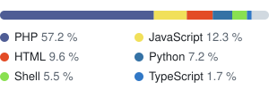

# Adrien Chinour

Backend developer · Bordeaux, France

<picture>
  <source media="(prefers-color-scheme: dark)" srcset="stats-dark.svg">
  
</picture>
<picture>
  <source media="(prefers-color-scheme: dark)" srcset="langs-dark.svg">
  
</picture>

[chinour.fr](https://chinour.fr)
